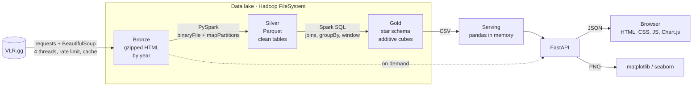

<div align="center">

# CompTracker

**Analytics for the men's VALORANT competitive scene, 2021–2026, built on a PySpark and Hadoop data lake.**

[](https://www.python.org/)
[](https://spark.apache.org/)
[](https://hadoop.apache.org/)
[](https://fastapi.tiangolo.com/)
[](https://www.chartjs.org/)
[](LICENSE)

[Português](README.md) · **English**


</div>

CompTracker collects the full history of competitive VALORANT from [VLR.gg](https://www.vlr.gg), organizes it in a
**layered data lake** (bronze → silver → gold) processed with **PySpark** on top of the **Hadoop FileSystem**, and
serves it through a **FastAPI** backend with an interactive web interface: team and player rankings, which side wins
more, map and agent meta, titles and prize money, and a round-by-round breakdown of every match.

Built for the **Big Data Topics in Python** university course. The interface is in Portuguese.

| 888 events | 41.7k matches | 83.5k maps | 1.7M rounds | 31k players | 1.4 GB of HTML |
|:---:|:---:|:---:|:---:|:---:|:---:|

## Contents

- [Features](#features)
- [Architecture](#architecture)
- [Technical highlights](#technical-highlights)
- [Tech stack](#tech-stack)
- [Getting started](#getting-started)
- [Configuration](#configuration)
- [API](#api)
- [Metric definitions](#metric-definitions)
- [Project structure](#project-structure)
- [Limitations](#limitations)
- [Credits and legal notice](#credits-and-legal-notice)
- [License](#license)

## Features

| Page | What it shows |
|---|---|
| **Overview** | Headline numbers for the current filter, which side wins more by year, matches per tier, how rounds are won and the favored side on each map |
| **Teams** | Rankings by series, map and round win rate, attack vs. defense, pistols and titles. Each team page has performance by year and map, roster, multikills, clutches and prize money |
| **Players** | Rankings across 15 metrics (rating, ACS, K/D, ADR, KAST, HS%, first kills, clutches, aces, 4K, 3K, 2K…), HS% distribution and rating vs. HS% |
| **Player profile** | Stats by year, team and agent, plus every map where the player was MVP, each linked to the full match |
| **Maps & agents** | Favored side per map, map pool over the years, agent meta, pick rate and win rate |
| **Titles** | Champion, runner-up and prize money for 886 events, Tier 1 playoff brackets and international titles by region |
| **Head to head** | A team's latest matches, or the history between two teams. Each match opens with per-map scores, a round timeline, the scoreboard and a player-vs-player kill matrix |
| **Data** | The pipeline, the size of each lake layer, data coverage and credits for every source |

**Across the app:**

- **Global filters** for tier, year, region, event type and event, applied to every chart and table.
- **23 interactive charts** (Chart.js), each also available as a PNG rendered with matplotlib/seaborn.
- **Search** for teams and players that ignores spaces, accents and case.
- **Light and dark themes** and **tables sortable** by any column.

<table>
  <tr>
    <td width="50%"></td>
    <td width="50%"></td>
  </tr>
  <tr>
    <td align="center"><sub>Match detail: rounds, scoreboard and kill matrix</sub></td>
    <td align="center"><sub>Player rankings</sub></td>
  </tr>
  <tr>
    <td width="50%"></td>
    <td width="50%"></td>
  </tr>
  <tr>
    <td align="center"><sub>Head to head</sub></td>
    <td align="center"><sub>Data lake pipeline</sub></td>
  </tr>
</table>

## Architecture



| Layer | Input | What happens | Output |
|---|---|---|---|
| **Collection** | VLR.gg pages | Discovers events and matches and downloads every page with rate limiting, retries and caching | Compressed HTML |
| **Bronze** | Downloaded HTML | Stores the raw data untouched, gzipped and partitioned by year (`year=YYYY`) | 86k files · 1.4 GB |
| **Silver** | Bronze | Parses scores, maps, rounds, per-player stats and prize money, and normalizes types, dates and currencies | Parquet · 250 MB |
| **Gold** | Silver | Builds a star schema (team, player and event dimensions) and cubes aggregated by entity, event and year | Parquet · 34 MB |
| **Serving** | Gold | Exports the cubes as CSV, which the API loads with pandas and filters on every request | JSON and PNG |
| **On demand** | Bronze | Reads a match's HTML only when someone opens it (rounds, scoreboard and kill matrix) | JSON |

## Technical highlights

- **Additive measures in the gold layer.** Cubes store sums, never averages. Average rating is stored as
  `rating × rounds` and `rounds`, and HS% as `hs × kills` and `kills`. Any filter (a year, a region, an event) is then
  just a sum of the matching rows divided at the end, which yields the **correct weighted average** instead of an
  average of averages.
- **Distributed single-pass parsing.** Spark reads the files with `binaryFile`, spreads them across cores and parses
  them with `mapPartitions`. Each record comes out as `(kind, JSON)` and is typed with `from_json`, so the HTML is
  read once even though it feeds six tables.
- **Incremental processing.** Only new matches are parsed; everything else is reused from staging.
- **Broadcast variables** for the event catalog and **window functions** (`row_number`) for each player's most recent
  record and the top performances of each event.
- **On-demand reads.** Match details skip Spark entirely: the API parses the bronze HTML when a match is opened, with
  an in-memory cache. Precomputing 41k kill matrices up front would be wasted work.
- **Version-keyed caching.** `lru_cache` on charts and heavy queries, with the data version in the key, so the cache
  refreshes itself after each ETL run (`POST /api/reload`).
- **Polite scraping.** A global requests-per-second limit, exponential backoff, atomic writes and a local cache: no
  page is ever downloaded twice.
- **Hybrid charts.** The same route serves JSON for Chart.js and a PNG via matplotlib/seaborn. Palettes are validated
  for color blindness.
- **Dependency-free face framing.** Banner photos are framed with a numpy-only detector (skin plus texture in a
  sliding window over an integral image), with manual adjustments stored in JSON.

## Tech stack

| Layer | Technology |
|---|---|
| Processing | **PySpark** 4 (Spark SQL, Parquet), **Apache Hadoop** 3.5 (FileSystem) |
| Analysis | **pandas**, **NumPy** |
| Visualization | **Chart.js** 4.4 (interactive), **matplotlib** and **seaborn** (PNG) |
| API | **FastAPI**, **Uvicorn** |
| Collection | **Requests**, **Beautiful Soup 4**, **Pillow** (images) |
| Front end | Plain HTML, CSS and JavaScript, no framework |

## Getting started

### Requirements

- **Python 3.11+**. Tested with Python 3.14.
- **Java 17+**, required by Spark. Tested with OpenJDK 21.
- **Windows:** the `winutils.exe` and `hadoop.dll` binaries are already in `hadoop/bin`.
- **Linux and macOS:** Spark does not need those binaries. The project was developed and tested on Windows 11.

### 1. Install

```bash
git clone https://github.com/<your-user>/CompTracker.git
cd CompTracker
python -m venv .venv
# Windows: .venv\Scripts\activate    Linux/macOS: source .venv/bin/activate
pip install -r requirements.txt
```

### 2. Collect the data

The data lake is not part of the repository; you build it locally. Collection is **resumable**: if it stops, just run
it again.

```bash
python -m scraper.run                       # Tiers 1, 2 and 3 (several hours the first time)
python -m scraper.run --tiers 60            # Tier 1 (VCT) only, much faster
python -m scraper.run --rps 1.5 --workers 4 # adjust the request rate
```

### 3. Spark pipeline

```bash
python -m etl.run                 # bronze → silver → gold → serving (incremental)
python -m etl.run --only gold     # rebuild only the aggregates (1–2 minutes)
python -m etl.run --full          # re-parse all the HTML
```

### 4. Images (optional)

Photos are not included in the repository (see [Credits and legal notice](#credits-and-legal-notice)). The app works
without them, using gradient banners and team logos instead of photos.

```bash
python -m scraper.title_photos              # title photos (official Riot Flickr)
python -m scraper.player_photos             # VCT player photos (Liquipedia, intentionally slow)
python -m scraper.leaders                   # list the leaders of every filter on the Players page
python -m scraper.player_photos --leaders   # photos for those leaders
```

For the Overview banner, put an image of your own at `web/img/banners/allcamps.jpg` (1600 × 900 recommended).

### 5. Run the server

```bash
uvicorn api.main:app --port 8000
```

Open **http://127.0.0.1:8000**. Interactive API docs are at **http://127.0.0.1:8000/docs**.
If you rerun the ETL while the server is up, call `POST /api/reload` to reload the data without restarting.

### Reference timings

Measured on a laptop with 12 logical cores.

| Step | Time |
|---|---|
| Full collection, all 3 tiers | about 8 hours at 3 requests/s |
| Full pipeline (parsing all HTML) | 2 to 2.5 hours |
| Incremental pipeline | proportional to new matches; about 16 min in the last run |
| Gold layer only | 1 to 2 minutes |

## Configuration

| Where | What |
|---|---|
| `COMPTRACKER_DATA` (environment variable) | Data lake folder. Defaults to `./data`. Useful to keep the lake outside synced folders such as OneDrive |
| `config.py` | Analysis period, tiers to collect, Tier 3 minimum prize, request rate and timeout |
| `config.PLAYER_NAME_OVERRIDES` | Player name fixes applied across the whole pipeline |
| `config.TEAM_COLORS` | Team colors used when the logo has no dominant color (black or white logos) |

```powershell
$env:COMPTRACKER_DATA = "D:\comptracker-data"   # PowerShell
export COMPTRACKER_DATA=~/comptracker-data      # bash/zsh
```

## API

Every data route accepts the `tier`, `year`, `region`, `event_type` and `event_id` filters. The full reference, with
examples, is at `/docs` (OpenAPI).

| Group | Routes |
|---|---|
| Metadata | `GET /api/meta` · `GET /api/search?q=` · `GET /api/lake` · `GET /api/coverage` · `GET /api/credits` |
| Overview | `GET /api/overview` |
| Teams | `GET /api/teams` · `GET /api/teams/{id}` · `GET /api/teams/{id}/matches` · `GET /api/teams/{id}/featured-title` · `GET /api/team-colors` |
| Players | `GET /api/players` · `GET /api/players/{id}` · `GET /api/players/{id}/mvp-maps` · `GET /api/players/{id}/hero` · `GET /api/players/featured` · `GET /api/players/metrics` · `GET /api/top-performances` |
| Matches | `GET /api/matches/{id}` · `GET /api/h2h?team_a=&team_b=` |
| Events and titles | `GET /api/titles` · `GET /api/featured-title` · `GET /api/events/{id}` · `GET /api/events/{id}/bracket` |
| Maps and agents | `GET /api/maps` · `GET /api/maps/featured` · `GET /api/agents` |
| Charts | `GET /api/chart-data/{name}` (JSON) · `GET /api/chart/{name}.png?theme=dark` |
| Images | `GET /api/logo/{team,event}/{id}` · `GET /api/photo/player/{id}` · `GET /api/asset/{map,agent}/{name}/{field}` |
| Admin | `POST /api/reload` |

```bash
curl "http://127.0.0.1:8000/api/teams?tier=1&year=2026&limit=5"
curl "http://127.0.0.1:8000/api/players?metric=clutches&tier=1&limit=10"
```

## Metric definitions

| Metric | Definition |
|---|---|
| **Tier 1** | VCT: leagues, Kickoff, Stages, Masters, Champions and Last Chance Qualifiers (plus the 2021–22 regional Challengers) |
| **Tier 2 / Tier 3** | Challengers and Ascension / independent tournaments with at least US$ 5k in prize money |
| **Rating** | VLR.gg per-map rating (1.00 = average player). Combines kills, deaths, assists, damage, KAST and first kills. Not the same as K/D |
| **Rating, ACS, ADR, KAST** | Averages weighted by rounds played |
| **HS%** | Per-map HS% weighted by kills |
| **Attack / defense** | Rounds won on each side ÷ rounds played on that side, regulation time only |
| **Favored side** | % of regulation rounds won by attackers. "pp" = percentage points above or below 50% |
| **Pistol** | Rounds 1 and 13 |
| **Clutch** | A round won as the team's last player alive (1v1 to 1v5) |
| **Multikill** | 2K, 3K, 4K and 5K (ace) in a single round |
| **Map MVP** | Highest rating among the 10 players (ties broken by ACS). "Team MVP" is the highest rating among the team's 5 |
| **Title** | 1st place in the prize table; without one, the grand final winner |
| **Prize money** | Converted to USD using the rate VLR.gg shows on the event total |
| **Minimum maps** | Automatic for rates: 1 map within an event, 5 within an event type, 20 within a year, 40 for the whole period. Counts have no minimum |

## Project structure

```
CompTracker/
├── config.py            lake paths, period, tiers and collection settings
├── scraper/             VLR.gg collection, photos (Liquipedia, Flickr) and leader list
├── etl/                 HTML parsers and the Spark pipeline (silver, gold, lake manifest)
├── api/                 FastAPI: filters, stats, charts, matches, images and coverage
├── web/                 interface (HTML, CSS, JS), local Chart.js and image credits
├── hadoop/bin/          winutils.exe and hadoop.dll for Spark on Windows
├── docs/screenshots/    images used in this README
└── requirements.txt
```

Every function has a one-line comment (in Portuguese) describing what it does.

## Limitations

- **Single source.** All data comes from VLR.gg, and the app mirrors whatever it publishes, including occasional errors.
- **Performance tab.** Some matches, mostly from China, have no performance tab on VLR.gg. They have no multikills or
  clutches; they are flagged and do not skew the rates.
- **Prize money.** 146 titles have no prize data on VLR.gg, and some prize tables list only the top places, such as
  Masters Copenhagen 2022, which stops at 8th.
- **2021.** Many open qualifiers with amateur teams. Use the event-type filter or the minimum-maps setting to focus on
  the main circuit.
- **Photos.** Not every player has a photo in the sources used. When there is no reliable photo, the app shows the
  team logo.

## Credits and legal notice

**Data:** [VLR.gg](https://www.vlr.gg) (matches, stats, prize money and logos) and
[Liquipedia](https://liquipedia.net/valorant) (player photos, via the MediaWiki API). Collection respects request
limits and keeps a local cache; please use it sparingly and follow each site's terms.

**Images:** title photos come from Riot Games' official Flickr accounts
([VALORANT Esports](https://www.flickr.com/photos/valorantesports/),
[VCT Americas](https://www.flickr.com/photos/vctamericas/),
[VCT EMEA](https://www.flickr.com/photos/vctemea/) and
[VCT Pacific](https://www.flickr.com/photos/vctpacific/)), and map and agent art comes from
[valorant-api.com](https://valorant-api.com). These images are **© Riot Games** and are **not distributed in this
repository**. `web/img/titulos/creditos.json` only stores each photo's link and photographer; running
`python -m scraper.title_photos` downloads them for local use.

**Fonts and libraries:** Inter and Inter Tight (SIL Open Font License 1.1); PySpark and Hadoop (Apache 2.0); pandas,
NumPy, seaborn and Uvicorn (BSD 3-Clause); matplotlib (PSF-based license); FastAPI, Beautiful Soup and Chart.js
(MIT); Requests (Apache 2.0); Pillow (MIT-CMU).

An academic, non-commercial project **not affiliated with Riot Games, VLR.gg or Liquipedia**. VALORANT and VALORANT
Champions Tour are registered trademarks of Riot Games, Inc.

## License

The code is released under the [MIT License](LICENSE). The license covers only the code in this repository, not the
collected data or third-party images.

---

<div align="center">
<sub>Contact: <a href="mailto:macedokayki@gmail.com">macedokayki@gmail.com</a></sub>
</div>
