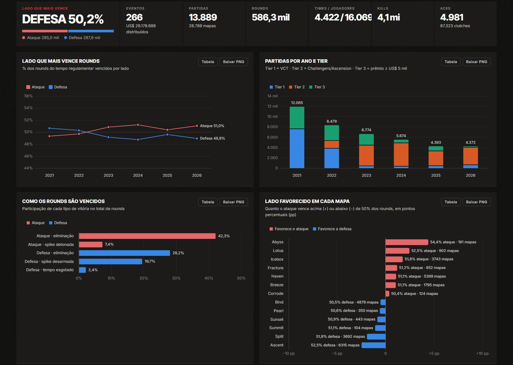
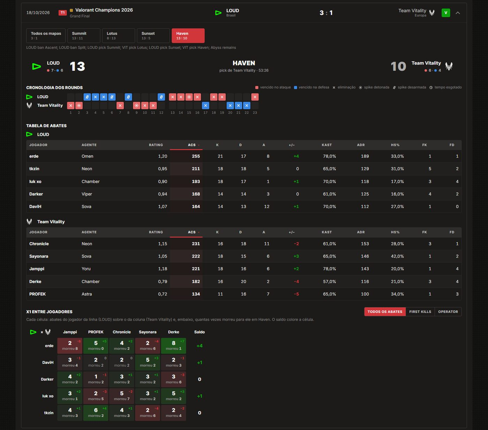
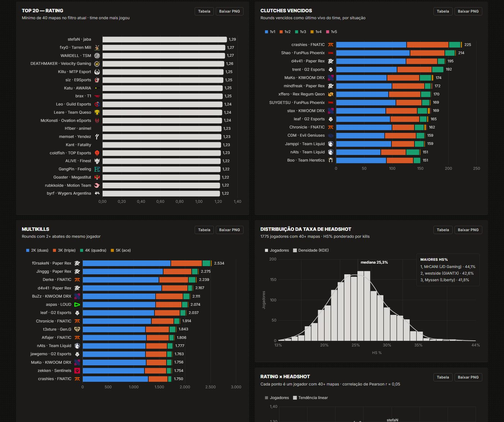
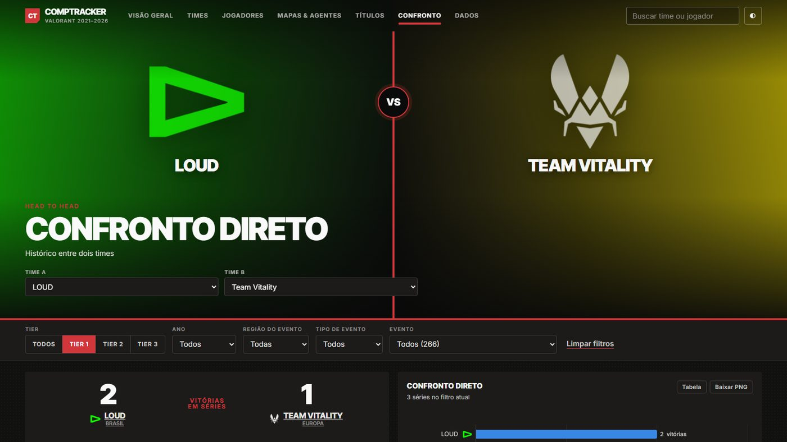
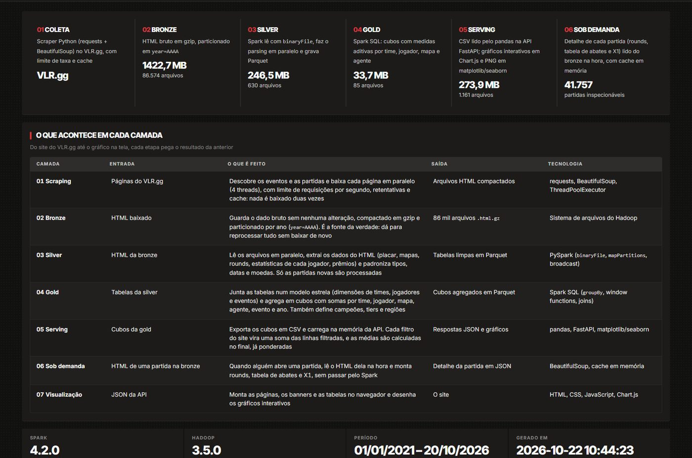
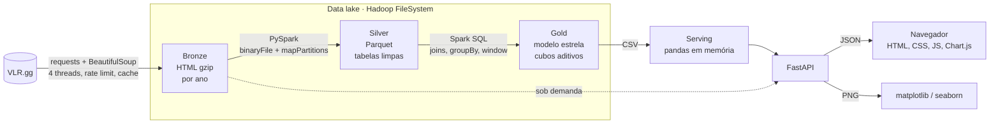

<div align="center">

# CompTracker

**Analytics do cenário competitivo masculino de VALORANT, de 2021 a 2026, sobre um data lake em PySpark e Hadoop.**

[](https://www.python.org/)
[](https://spark.apache.org/)
[](https://hadoop.apache.org/)
[](https://fastapi.tiangolo.com/)
[](https://www.chartjs.org/)
[](LICENSE)

**Português** · [English](README.en.md)



</div>

O CompTracker coleta o histórico completo do VALORANT competitivo no [VLR.gg](https://www.vlr.gg), organiza os dados
num **data lake em camadas** (bronze → silver → gold) processado com **PySpark** sobre o **FileSystem do Hadoop**, e
serve tudo por uma **API FastAPI** com uma interface web interativa: rankings de times e jogadores, lado que mais
vence, meta de mapas e agentes, títulos e premiações, e o detalhe de cada partida, round a round.

Projeto desenvolvido para a disciplina **Tópicos de Big Data em Python**.

| 888 eventos | 41,7 mil partidas | 83,5 mil mapas | 1,7 milhão de rounds | 31 mil jogadores | 1,4 GB de HTML |
|:---:|:---:|:---:|:---:|:---:|:---:|

## Sumário

- [Funcionalidades](#funcionalidades)
- [Arquitetura](#arquitetura)
- [Destaques técnicos](#destaques-técnicos)
- [Tecnologias](#tecnologias)
- [Como rodar](#como-rodar)
- [Configuração](#configuração)
- [API](#api)
- [Definições das métricas](#definições-das-métricas)
- [Estrutura do projeto](#estrutura-do-projeto)
- [Limitações](#limitações)
- [Créditos e aviso legal](#créditos-e-aviso-legal)
- [Licença](#licença)

## Funcionalidades

| Página | O que mostra |
|---|---|
| **Visão geral** | Indicadores do filtro atual, lado que mais vence por ano, partidas por tier, como os rounds são vencidos e lado favorecido em cada mapa |
| **Times** | Ranking com win rate de séries, mapas e rounds, ataque × defesa, pistols e títulos. Cada time tem desempenho por ano e por mapa, elenco, multikills, clutches e prêmios |
| **Jogadores** | Rankings por 15 métricas (rating, ACS, K/D, ADR, KAST, HS%, first kills, clutches, aces, 4K, 3K, 2K...), distribuição de HS% e rating × HS% |
| **Perfil do jogador** | Estatísticas por ano, time e agente, e todos os mapas em que ele foi MVP, cada um com a partida completa |
| **Mapas & agentes** | Lado favorecido por mapa, map pool ao longo dos anos, meta de agentes, pick rate e win rate |
| **Títulos** | Campeão, vice e premiação de 886 eventos, chaveamento dos playoffs do Tier 1 e títulos internacionais por região |
| **Confronto** | Últimas partidas de um time ou o histórico entre dois. Cada partida abre com placar por mapa, cronologia dos rounds, tabela de abates e X1 entre jogadores |
| **Dados** | O pipeline, o tamanho de cada camada do lake, a cobertura dos dados e os créditos de todas as fontes |

**Recursos em todo o app:**

- **Filtros globais** de tier, ano, região, tipo de evento e evento, aplicados a todos os gráficos e tabelas.
- **23 gráficos interativos** (Chart.js), cada um também disponível em PNG gerado com matplotlib/seaborn.
- **Busca** por times e jogadores, que ignora espaços, acentos e maiúsculas.
- **Tema claro e escuro** e **tabelas ordenáveis** por qualquer coluna.

<table>
  <tr>
    <td width="50%"></td>
    <td width="50%"></td>
  </tr>
  <tr>
    <td align="center"><sub>Detalhe da partida: rounds, tabela de abates e X1</sub></td>
    <td align="center"><sub>Rankings de jogadores</sub></td>
  </tr>
  <tr>
    <td width="50%"></td>
    <td width="50%"></td>
  </tr>
  <tr>
    <td align="center"><sub>Confronto direto</sub></td>
    <td align="center"><sub>Pipeline do data lake</sub></td>
  </tr>
</table>

## Arquitetura



| Camada | Entrada | O que é feito | Saída |
|---|---|---|---|
| **Coleta** | Páginas do VLR.gg | Descobre os eventos e as partidas e baixa cada página com limite de requisições, retentativas e cache | HTML compactado |
| **Bronze** | HTML baixado | Guarda o dado bruto sem alteração, em gzip, particionado por ano (`year=AAAA`) | 86 mil arquivos · 1,4 GB |
| **Silver** | Bronze | Extrai do HTML placares, mapas, rounds, estatísticas por jogador e premiações, e padroniza tipos, datas e moedas | Parquet · 250 MB |
| **Gold** | Silver | Monta o modelo estrela (dimensões de times, jogadores e eventos) e os cubos agregados por entidade, evento e ano | Parquet · 34 MB |
| **Serving** | Gold | Exporta os cubos em CSV, que a API carrega com pandas e filtra a cada requisição | JSON e PNG |
| **Sob demanda** | Bronze | Lê o HTML de uma partida só quando alguém a abre (rounds, tabela de abates e X1) | JSON |

## Destaques técnicos

- **Medidas aditivas na camada gold.** Os cubos guardam somas, nunca médias. O rating médio é guardado como
  `rating × rounds` e `rounds`, e o HS% como `hs × kills` e `kills`. Assim qualquer filtro (um ano, uma região, um
  evento) é só somar as linhas do recorte e dividir no final, o que dá a **média ponderada correta**, sem o erro de
  tirar média de médias.
- **Parsing distribuído em uma passada.** O Spark lê os arquivos com `binaryFile`, distribui entre os núcleos e faz o
  parsing com `mapPartitions`. Cada registro sai como `(tipo, JSON)` e é tipado com `from_json`, então o HTML é lido
  uma vez só, mesmo gerando seis tabelas.
- **Processamento incremental.** Só as partidas novas passam pelo parsing; o restante é reaproveitado da staging.
- **Broadcast variables** para o catálogo de eventos e **window functions** (`row_number`) para o "registro mais
  recente" de cada jogador e as maiores performances de cada evento.
- **Leitura sob demanda.** O detalhe de uma partida não passa pelo Spark: a API lê o HTML da bronze quando alguém
  clica, com cache em memória. Processar as 41 mil matrizes de abate de antemão seria desperdício.
- **Cache com invalidação por versão.** `lru_cache` em gráficos e consultas pesadas, com a versão dos dados na chave:
  o cache se renova sozinho depois de cada ETL (`POST /api/reload`).
- **Coleta respeitosa.** Limite global de requisições por segundo, retentativas com espera exponencial, gravação
  atômica e cache local: nenhuma página é baixada duas vezes.
- **Gráficos híbridos.** A mesma rota entrega os dados em JSON para o Chart.js e o gráfico em PNG para o
  matplotlib/seaborn. As paletas foram validadas para daltonismo.
- **Detector de rosto sem dependências.** O enquadramento das fotos nos banners usa só numpy (pele mais textura numa
  janela deslizante com imagem integral), com ajustes manuais salvos em JSON.

## Tecnologias

| Camada | Tecnologia |
|---|---|
| Processamento | **PySpark** 4 (Spark SQL, Parquet), **Apache Hadoop** 3.5 (FileSystem) |
| Análise | **pandas**, **NumPy** |
| Visualização | **Chart.js** 4.4 (interativo), **matplotlib** e **seaborn** (PNG) |
| API | **FastAPI**, **Uvicorn** |
| Coleta | **Requests**, **Beautiful Soup 4**, **Pillow** (imagens) |
| Front-end | HTML, CSS e JavaScript puros, sem framework |

## Como rodar

### Pré-requisitos

- **Python 3.11+**. Testado com Python 3.14.
- **Java 17+**, exigido pelo Spark. Testado com OpenJDK 21.
- **Windows:** os binários `winutils.exe` e `hadoop.dll` já estão em `hadoop/bin`.
- **Linux e macOS:** o Spark não precisa desses binários. O projeto foi desenvolvido e testado no Windows 11.

### 1. Instalação

```bash
git clone https://github.com/<seu-usuario>/CompTracker.git
cd CompTracker
python -m venv .venv
# Windows: .venv\Scripts\activate    Linux/macOS: source .venv/bin/activate
pip install -r requirements.txt
```

### 2. Coleta dos dados

O data lake não vai no repositório; ele é gerado na sua máquina. A coleta é **retomável**: se for interrompida, basta
rodar de novo.

```bash
python -m scraper.run                       # Tier 1, 2 e 3 (várias horas na primeira vez)
python -m scraper.run --tiers 60            # só o Tier 1 (VCT), bem mais rápido
python -m scraper.run --rps 1.5 --workers 4 # ajusta o ritmo da coleta
```

### 3. Pipeline Spark

```bash
python -m etl.run                 # bronze → silver → gold → serving (incremental)
python -m etl.run --only gold     # refaz só os agregados (1 a 2 minutos)
python -m etl.run --full          # refaz o parsing de todo o HTML
```

### 4. Imagens (opcional)

As fotos não fazem parte do repositório (veja [Créditos e aviso legal](#créditos-e-aviso-legal)). Sem elas o app
funciona normalmente, com banners em gradiente e o logo do time no lugar das fotos.

```bash
python -m scraper.title_photos              # fotos dos títulos (Flickr oficial da Riot)
python -m scraper.player_photos             # fotos dos jogadores do VCT (Liquipedia, lento de propósito)
python -m scraper.leaders                   # lista os líderes de cada filtro da página Jogadores
python -m scraper.player_photos --leaders   # fotos desses líderes
```

Para o banner da Visão geral, coloque uma imagem sua em `web/img/banners/allcamps.jpg` (1600 × 900 recomendado).

### 5. Servidor

```bash
uvicorn api.main:app --port 8000
```

Abra **http://127.0.0.1:8000**. A documentação interativa da API fica em **http://127.0.0.1:8000/docs**.
Se rodar o ETL com o servidor no ar, chame `POST /api/reload` para recarregar os dados sem reiniciar.

### Tempos de referência

Medidos num notebook com 12 núcleos lógicos.

| Etapa | Tempo |
|---|---|
| Coleta completa dos 3 tiers | cerca de 8 horas a 3 requisições/s |
| Pipeline completo (parsing de todo o HTML) | 2 a 2,5 horas |
| Pipeline incremental | proporcional às partidas novas; cerca de 16 min no último ciclo |
| Só a camada gold | 1 a 2 minutos |

## Configuração

| Onde | O quê |
|---|---|
| `COMPTRACKER_DATA` (variável de ambiente) | Pasta do data lake. O padrão é `./data`. Útil para guardar o lake fora de pastas sincronizadas, como o OneDrive |
| `config.py` | Período analisado, tiers coletados, prêmio mínimo do Tier 3, ritmo e timeout das requisições |
| `config.PLAYER_NAME_OVERRIDES` | Correções de nome de jogador aplicadas em todo o pipeline |
| `config.TEAM_COLORS` | Cores de time usadas quando o logo não tem cor dominante (logos pretos ou brancos) |

```powershell
$env:COMPTRACKER_DATA = "D:\comptracker-data"   # PowerShell
export COMPTRACKER_DATA=~/comptracker-data      # bash/zsh
```

## API

Todas as rotas de dados aceitam os filtros `tier`, `year`, `region`, `event_type` e `event_id`. A referência completa,
com exemplos, fica em `/docs` (OpenAPI).

| Grupo | Rotas |
|---|---|
| Metadados | `GET /api/meta` · `GET /api/search?q=` · `GET /api/lake` · `GET /api/coverage` · `GET /api/credits` |
| Visão geral | `GET /api/overview` |
| Times | `GET /api/teams` · `GET /api/teams/{id}` · `GET /api/teams/{id}/matches` · `GET /api/teams/{id}/featured-title` · `GET /api/team-colors` |
| Jogadores | `GET /api/players` · `GET /api/players/{id}` · `GET /api/players/{id}/mvp-maps` · `GET /api/players/{id}/hero` · `GET /api/players/featured` · `GET /api/players/metrics` · `GET /api/top-performances` |
| Partidas | `GET /api/matches/{id}` · `GET /api/h2h?team_a=&team_b=` |
| Eventos e títulos | `GET /api/titles` · `GET /api/featured-title` · `GET /api/events/{id}` · `GET /api/events/{id}/bracket` |
| Mapas e agentes | `GET /api/maps` · `GET /api/maps/featured` · `GET /api/agents` |
| Gráficos | `GET /api/chart-data/{nome}` (JSON) · `GET /api/chart/{nome}.png?theme=dark` |
| Imagens | `GET /api/logo/{team,event}/{id}` · `GET /api/photo/player/{id}` · `GET /api/asset/{map,agent}/{nome}/{campo}` |
| Administração | `POST /api/reload` |

```bash
curl "http://127.0.0.1:8000/api/teams?tier=1&year=2026&limit=5"
curl "http://127.0.0.1:8000/api/players?metric=clutches&tier=1&limit=10"
```

## Definições das métricas

| Métrica | Definição |
|---|---|
| **Tier 1** | VCT: ligas, Kickoff, Stages, Masters, Champions e Last Chance Qualifiers (e os Challengers regionais de 2021–22) |
| **Tier 2 / Tier 3** | Challengers e Ascension / torneios independentes com prêmio de pelo menos US$ 5 mil |
| **Rating** | Nota do VLR.gg por mapa (1,00 = jogador médio). Combina kills, mortes, assistências, dano, KAST e first kills. Não é o K/D |
| **Rating, ACS, ADR, KAST** | Médias ponderadas pelos rounds jogados |
| **HS%** | HS% de cada mapa ponderado pelo número de kills |
| **Ataque / defesa** | Rounds vencidos em cada lado ÷ rounds jogados naquele lado, só no tempo regulamentar |
| **Lado favorecido** | % dos rounds regulamentares vencidos pelo ataque. "pp" = pontos percentuais acima ou abaixo de 50% |
| **Pistol** | Rounds 1 e 13 |
| **Clutch** | Round vencido como último jogador vivo do time (1v1 a 1v5) |
| **Multikill** | 2K, 3K, 4K e 5K (ace) num mesmo round |
| **MVP do mapa** | Maior rating entre os 10 jogadores (desempate pelo ACS). "MVP do time" é o maior rating entre os 5 do time |
| **Título** | 1º lugar na tabela de premiação; sem tabela, o vencedor da grande final |
| **Premiação** | Convertida para dólar pela taxa que o próprio VLR.gg informa no total do evento |
| **Mínimo de mapas** | Automático para taxas: 1 mapa num evento, 5 num tipo de evento, 20 num ano e 40 no período. Contagens não exigem mínimo |

## Estrutura do projeto

```
CompTracker/
├── config.py            caminhos do lake, período, tiers e parâmetros da coleta
├── scraper/             coleta do VLR.gg, fotos (Liquipedia, Flickr) e lista de líderes
├── etl/                 parsers do HTML e pipeline Spark (silver, gold, manifesto do lake)
├── api/                 FastAPI: filtros, estatísticas, gráficos, partidas, imagens e cobertura
├── web/                 interface (HTML, CSS, JS), Chart.js local e créditos das imagens
├── hadoop/bin/          winutils.exe e hadoop.dll para o Spark no Windows
├── docs/screenshots/    imagens deste README
└── requirements.txt
```

Cada função do código tem um comentário de uma linha dizendo o que faz.

## Limitações

- **Fonte única.** Todos os dados vêm do VLR.gg, e o app reproduz o que ele publica, inclusive eventuais erros.
- **Aba de performance.** Algumas partidas, principalmente da China, não têm essa aba no VLR.gg. Nelas não há
  multikills nem clutches; elas ficam marcadas e não distorcem as taxas.
- **Premiações.** 146 títulos não têm nenhum prêmio publicado no VLR.gg, e algumas tabelas listam só as primeiras
  colocações, como a do Masters Copenhagen 2022, que vai só até o 8º lugar.
- **2021.** Há muitas qualificatórias abertas com times amadores. Use o filtro de tipo de evento ou o mínimo de mapas
  para focar no circuito principal.
- **Fotos.** Nem todo jogador tem foto nas fontes usadas. Quando não há uma foto confiável, o app mostra o logo do time.

## Créditos e aviso legal

**Dados:** [VLR.gg](https://www.vlr.gg) (partidas, estatísticas, premiações e logos) e
[Liquipedia](https://liquipedia.net/valorant) (fotos dos jogadores, via API MediaWiki). A coleta respeita limites de
requisição e mantém cache local; use com moderação e siga os termos de cada site.

**Imagens:** as fotos dos títulos vêm dos Flickr oficiais da Riot Games
([VALORANT Esports](https://www.flickr.com/photos/valorantesports/),
[VCT Americas](https://www.flickr.com/photos/vctamericas/),
[VCT EMEA](https://www.flickr.com/photos/vctemea/) e
[VCT Pacific](https://www.flickr.com/photos/vctpacific/)), e as artes de mapas e agentes vêm do
[valorant-api.com](https://valorant-api.com). Essas imagens são **© Riot Games** e **não são distribuídas neste
repositório**. O arquivo `web/img/titulos/creditos.json` guarda só o link de cada foto e o nome do fotógrafo; o
comando `python -m scraper.title_photos` baixa as fotos para uso local.

**Fontes e bibliotecas:** Inter e Inter Tight (SIL Open Font License 1.1); PySpark e Hadoop (Apache 2.0); pandas,
NumPy, seaborn e Uvicorn (BSD 3-Clause); matplotlib (licença PSF); FastAPI, Beautiful Soup e Chart.js (MIT); Requests
(Apache 2.0); Pillow (MIT-CMU).

Projeto acadêmico, sem fins comerciais e **sem vínculo com a Riot Games, o VLR.gg ou a Liquipedia**. VALORANT e
VALORANT Champions Tour são marcas registradas da Riot Games, Inc.

## Licença

O código é distribuído sob a licença [MIT](LICENSE). A licença cobre só o código deste repositório, e não os dados
coletados nem as imagens de terceiros.

---

<div align="center">
<sub>Contato: <a href="mailto:macedokayki@gmail.com">macedokayki@gmail.com</a></sub>
</div>
